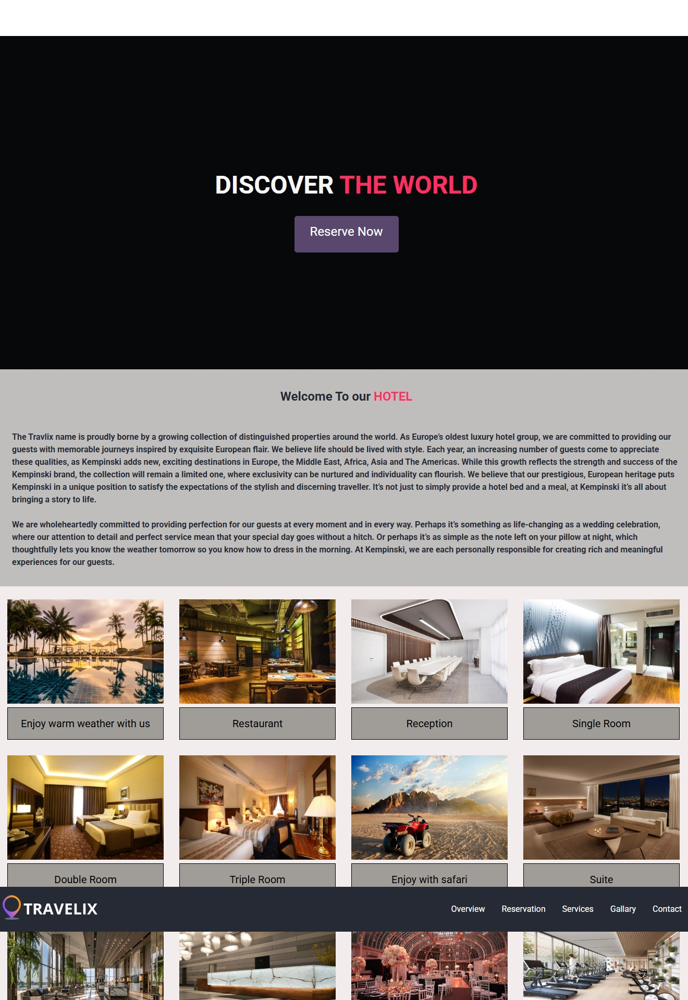
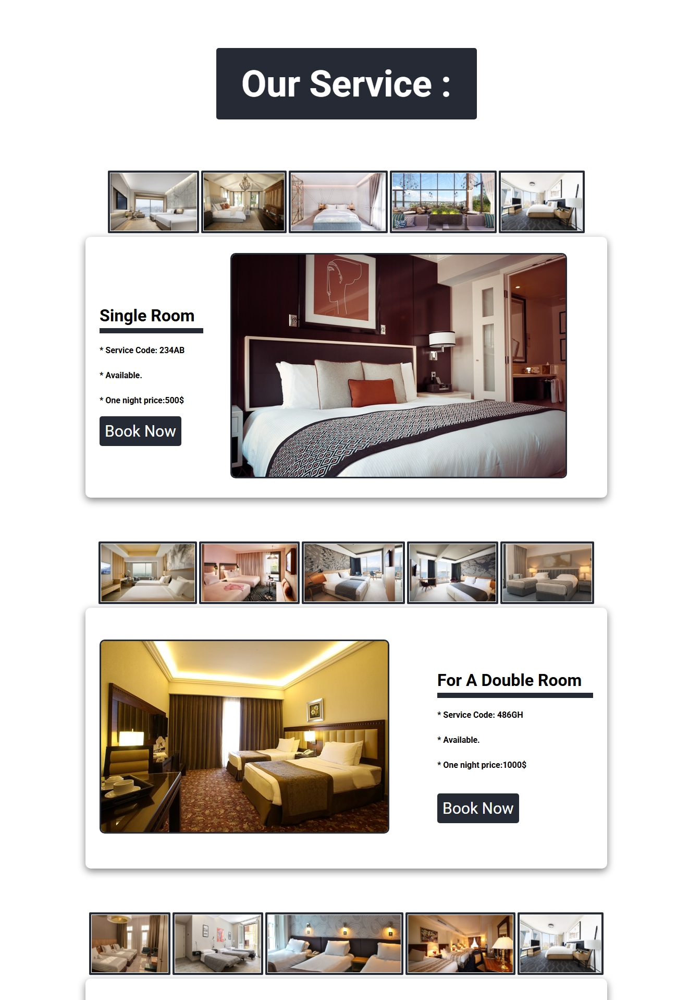
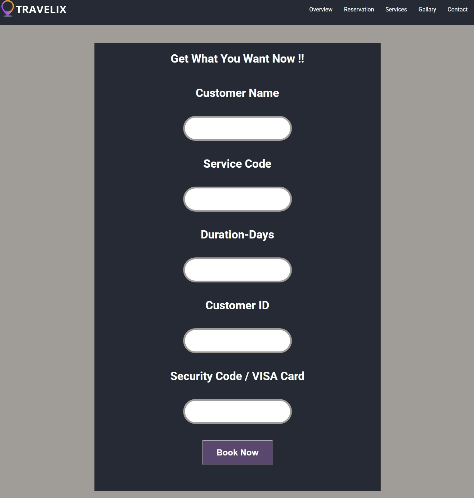

# 🏨 Travelix Hotel

A hotel website built with **HTML and CSS**. Visitors can explore the hotel's facilities, browse the available rooms with their details and prices, and fill in a reservation form to book a stay.

🔗 **Live Demo:** [eman8382534-dev.github.io/travelix-hotel](https://eman8382534-dev.github.io/travelix-hotel/)

## Pages

| Page | File | Description |
|------|------|-------------|
| Home | `index.html` | Hero section, welcome text about the hotel, and a gallery of the hotel's facilities |
| Services | `services.html` | Rooms and services with photos, service code, availability and price per night |
| Reservation | `Reserv.html` | Booking form |

## Features

- Hero section with a clear "Reserve Now" call to action
- Welcome section introducing the hotel
- Facilities gallery: pool, restaurant, reception, meeting room, wedding hall, gym, safari trips and more
- Room types: Single, Double, Triple and Suite
- Room details: service code, availability and one-night price
- Photo thumbnails for every room
- Reservation form: customer name, service code, duration in days, customer ID
- Fixed navigation bar across the pages

## Screenshots

### Home Page


### Services Page


### Reservation Page


## Tech Stack

- **HTML5**: page structure
- **CSS3**: layout and styling (separate stylesheets for the home, services and reservation pages)

## Project Structure

```
travelix-hotel/
├── index.html         # Home page
├── services.html      # Rooms and services
├── Reserv.html        # Reservation form
├── css/               # Stylesheets
├── img/               # Hotel and room images
└── screenshots/       # README screenshots
```

## Run Locally

1. Clone the repository:
   ```bash
   git clone https://github.com/eman8382534-dev/travelix-hotel.git
   ```
2. Open the folder in VS Code.
3. Right-click `index.html` and choose **Open with Live Server** (or just open `index.html` in your browser).

## Note

This is a front-end demo project. The reservation form does not process real payments, so please do not enter real card details.

## Author

**Eman Ashraf**
